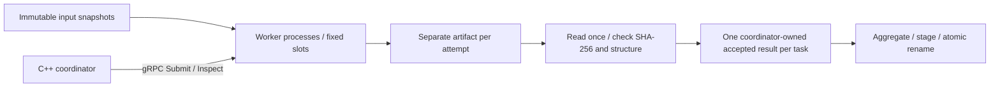

# StragglerMR

A C++20/gRPC MapReduce runtime that reduces straggler latency through bounded speculative execution. A coordinator distributes word-count tasks across worker processes, retries failed attempts and validates results before publishing output.

Under severe synthetic worker slowdown, speculation achieved **3.708× median paired speedup**, reducing median job latency from **1,668 ms to 449 ms**. The 30-run study also measures when speculation adds work without improving latency.

## Architecture



Deployment is one host with trusted workers and a shared local filesystem. Workers use fixed execution pools; each logical task, execution attempt and job has a separate identity. Duplicate admission is idempotent. RPC deadlines, execution timeouts, finite attempt budgets and a job deadline bound failure handling. Lost replies are reconciled through Inspect. A timeout or losing result does not prove computation stopped, so outstanding work keeps its physical capacity charge.

Candidates have attempt-specific workspaces. The coordinator checks size, SHA-256, identity and record grammar, validates the exact bytes read, and publishes its own copy. Only one valid result is accepted per task. Late writes cannot change accepted bytes; final output becomes visible through a sibling staging file and atomic rename. Hashes detect accidental mutation relative to trusted worker metadata; they do not prove arbitrary semantic correctness. Tests compare full output with a separate Python serial oracle.

## Frozen speculative policy v1

Speculation defaults off; enable with `mr_coordinator --speculation on ...`. Only a still-eligible first normal attempt qualifies. Ordinary pending initial/retry tasks take priority. Require at least five accepted first-normal peers within an input-size ratio of 1.25, then age ≥max(200 ms, 3× their upper-median runtime). Launch on another healthy worker's unused capacity with more than one control-RPC timeout remaining before execution expiry.

Limits are one backup per task and two physically outstanding backups globally, sharing the total attempt budget (default three, maximum five). Expired, superseded and unreachable backups do not free that limit without terminal confirmation. Reasons are recorded as normal, failure_retry, deadline_retry or speculation. No thresholds were fitted to the measured results. See the [full policy](docs/speculative-policy.md) and [representative execution trace](docs/execution-trace.md).

## Build and test

The full suite contains **34 correctness and fault tests**, including competing attempts, crashes, lost replies, corrupt artifacts, admission limits and output checks against an independent serial oracle. Debug and Release passed on macOS and Linux; see [validation results](docs/release-validation.md) for sanitizer coverage.


Requirements: C++20, CMake ≥3.24, gRPC C++ and its generator, Protobuf and protoc, OpenSSL Crypto, Python ≥3.9. Python orchestration, oracle and plotting use the standard library. Generated bindings and third-party binaries are not bundled.

Apple Silicon development setup (select the deployment target/prefix appropriate to your installed libraries):

```sh
HOMEBREW_NO_INSTALL_CLEANUP=1 brew install cmake grpc
cmake -S . -B build-debug -DCMAKE_BUILD_TYPE=Debug \
  -DCMAKE_PREFIX_PATH="$(brew --prefix)" -DCMAKE_OSX_DEPLOYMENT_TARGET=27.0
cmake --build build-debug -j 3
ctest --test-dir build-debug --output-on-failure -j 2
cmake -S . -B build-release -DCMAKE_BUILD_TYPE=Release \
  -DCMAKE_PREFIX_PATH="$(brew --prefix)" -DCMAKE_OSX_DEPLOYMENT_TARGET=27.0
cmake --build build-release -j 3
ctest --test-dir build-release --output-on-failure -j 2
```

Debian Linux dependencies and build:

```sh
apt-get update
apt-get install -y g++ cmake make pkg-config libgrpc++-dev protobuf-compiler-grpc libprotobuf-dev libssl-dev
cmake -S . -B build-release -DCMAKE_BUILD_TYPE=Release
cmake --build build-release -j 3
ctest --test-dir build-release --output-on-failure -j 1
```

An optional local dependency image is defined in `packaging/Dockerfile`; it is a build/test convenience, not a cluster deployment. Tests need loopback listening sockets. In restricted environments, use an execution mode that permits them. See [release validation](docs/release-validation.md) for actual tested versions and sanitizer outcomes.

```sh
python3 scripts/demo.py --bin-dir build-release --run-dir runs/demo
python3 tests/speculation.py --bin-dir build-release --case backup_wins --keep runs/speculative-demo
```

Use new run directories. The gated test holds both attempts, releases the backup to acceptance, releases the original late, and checks exact oracle output, rejection, unchanged accepted/final bytes and process cleanup. Workspaces/logs remain local; the launcher stops and waits for its workers. Remove retained runs when no longer needed.

## Results and reproduction

The controlled study used 24 equal-size word-count inputs, injected service slowdowns on **one local host**, and three matched repetitions per off/on configuration, with execution order rotated.

| Scenario | Retry-only median job ms | Speculation median job ms | Median paired speedup |
| --- | ---: | ---: | ---: |
| Healthy | 329 | 332 | 0.991× |
| Severe synthetic straggler | 1668 | 449 | **3.708×** |
| Several moderate stragglers | 668 | 665 | 1.007× |
| No spare capacity | 2036 | 2035 | 0.998× |
| Delayed crash | 724 | 449 | 1.615× |

Moderate runs launched two backups each and none won. Five of fifteen matched pairs regressed in publication latency. Severe runs added a median paired 1.90% occupied-slot time and 7.91% worker-thread CPU; speculative CPU alone was 8.12% of matched baseline CPU. Losing originals accounted for 60.57% of enabled occupied time in that condition. Losers are not cancelled: earlier publication can coexist with a longer full process/drain duration. CPU totals are small/noisy; three repetitions are not a significance claim. [All results, costs and plots](reports/phase2-performance.md).

Recompute the published comparisons **without running a benchmark**:

```sh
python3 packaging/verify_evidence.py
python3 benchmarks/analyze.py --raw data/phase2 --output reports/recomputed
```

The [published evidence](data/phase2/README.md) includes numerical CSV/JSON, per-attempt outcomes, input/result hashes and source/binary fingerprints.

Run the same study and analysis:

```sh
python3 benchmarks/run_study.py --bin-dir build-release --output runs/study-reproduction
python3 benchmarks/analyze.py --raw runs/study-reproduction --output reports/reproduction
```

## Limits and references

Only the fixed ASCII word-count workload is supported. There is no remote file transfer, shuffle service, general mapper/reducer API, coordinator recovery, worker restart/rejoin, consensus, hostile-worker isolation or durable machine/storage-failure commit. Input byte size is a limited comparability proxy. Worker history is bounded; long studies should use fresh workers. Launchers own shutdown and retained artifact cleanup. See [the failure contract](docs/architecture.md).

- Jeffrey Dean and Sanjay Ghemawat, [MapReduce: Simplified Data Processing on Large Clusters](https://research.google/pubs/mapreduce-simplified-data-processing-on-large-clusters/), OSDI 2004.
- Matei Zaharia, Andy Konwinski, Anthony D. Joseph, Randy Katz and Ion Stoica, [Improving MapReduce Performance in Heterogeneous Environments](https://www.usenix.org/legacy/event/osdi08/tech/full_papers/zaharia/zaharia_html/), OSDI 2008 (LATE).

StragglerMR uses an elapsed-time heuristic; LATE provides background on speculative scheduling.

## License

[MIT](LICENSE), copyright 2026 Yixuan Zheng. See [third-party notices](THIRD-PARTY-NOTICES.md) for dependency licenses.
