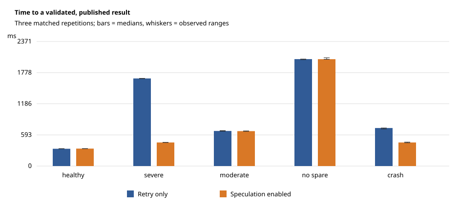
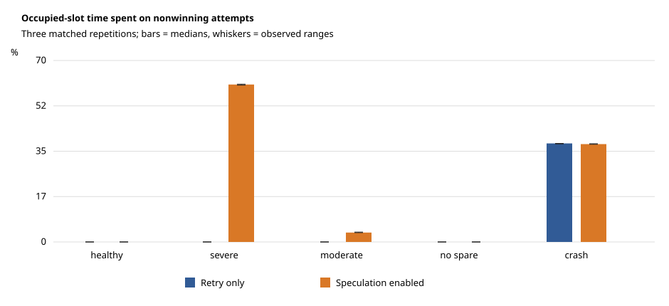

# Phase 2 controlled performance study

Frozen policy v1; 30 serial runs, five scenarios, three matched repetitions per mode. Every run passed the independent serial oracle and complete local attempt-timing reconciliation. No run was filtered for performance.

Job latency below starts at coordinator construction (including input snapshots) and ends after final atomic publication. Map latency starts at first dispatch and ends after all maps are validated and accepted, before final publication. The CSV also includes external coordinator-launch-to-publication observation (5 ms polling) and full process/drain duration. Worker startup is excluded. Full drain time is not hidden inside the latency improvement.

| Scenario | Retry-only job median [range], ms | Speculation job median [range], ms | Median paired speedup | Backups / wins per enabled run |
| --- | --- | --- | --- | --- |
| healthy | 329 [329, 332] | 332 [330, 333] | 0.991× | 0/0, 0/0, 0/0 |
| severe | 1668 [1665, 1670] | 449 [448, 452] | 3.708× | 1/1, 1/1, 1/1 |
| moderate | 668 [664, 674] | 665 [661, 669] | 1.007× | 2/0, 2/0, 2/0 |
| no_spare | 2036 [2027, 2037] | 2035 [2032, 2062] | 0.998× | 0/0, 0/0, 0/0 |
| crash | 724 [707, 725] | 449 [444, 456] | 1.615× | 1/1, 1/1, 1/1 |



| Scenario | Map medians off / on, ms | Paired CPU change | Paired slot-time change | Speculative CPU / baseline CPU | Wasted CPU fraction (on) | Wasted slot fraction (on) |
| --- | --- | --- | --- | --- | --- | --- |
| healthy | 324 / 326 | +3.93% | +2.40% | 0.00% | 0.00% | 0.00% |
| severe | 1662 / 443 | +7.91% | +1.90% | 8.12% | 12.15% | 60.57% |
| moderate | 662 / 659 | -2.85% | +3.56% | 5.72% | 5.89% | 3.62% |
| no_spare | 2032 / 2032 | -4.39% | -0.13% | 0.00% | 0.00% | 0.00% |
| crash | 718 / 444 | +2.32% | +0.22% | 7.23% | 0.97% | 37.65% |

Percentages are medians of matched pair values, not ratios of unrelated averages. CPU change includes ordinary, retry, original and backup execution; it can be negative due to noise or avoided retries. Speculative CPU/baseline is separately measured backup work. Wasted work means **all nonwinning attempts**, including a slow original defeated by its backup; it is not restricted to speculative losers.

Occupied-slot time includes controlled sleep, map computation and candidate I/O up to the timing boundary. Thread CPU time uses CLOCK_THREAD_CPUTIME_ID and excludes sleeping; it excludes the final timing-file write and process/gRPC thread overhead. This is a synthetic slowdown study of the existing word-count workload, not a real cluster or CPU-intensive throughput benchmark.



## Outcomes and negative findings

- healthy: matched job latency changes, repetitions 0–2: +0.91%, +1.22%, -0.60%.
- severe: matched job latency changes, repetitions 0–2: -72.90%, -73.17%, -73.03%.
- moderate: matched job latency changes, repetitions 0–2: -1.05%, +0.15%, -0.74%.
- no_spare: matched job latency changes, repetitions 0–2: -0.10%, +0.25%, +1.28%.
- crash: matched job latency changes, repetitions 0–2: -38.67%, -35.50%, -38.07%.

5 of 15 matched pairs had higher job latency with speculation enabled. Three repetitions expose some natural variability but are too few for strong statistical significance claims. No significance or general speedup guarantee is claimed.

Speculation does not cancel losers. Faster result publication can therefore coexist with almost unchanged time until all workers become idle. The full process/drain durations are retained in the CSV; the large wasted occupied-slot fractions in straggler cases include the original's injected delay. CPU costs are small and noisy at this scale. The saturated control deliberately has one worker/one slot and cannot place a backup on another worker. Concurrent multiworker saturation and supersession accounting are tested separately with deterministic gates.

## Evidence and reproduction

- Frozen policy: `docs/speculative-policy.md`; frozen schedules: `benchmarks/manifest.json`.
- Evidence input directory: `data/phase2`.
- This directory contains sanitized numerical observations from the original Phase 2 study. Full internal runs are retained privately and are not redistributed.
- The study's manifest includes source and binary SHA-256 fingerprints. `observations.jsonl` preserves every run, and the CSV/pair JSON preserve every numerical comparison.
- Injected crashes write a timing record before exiting; the study reconciles this local evidence because the coordinator cannot retrieve a terminal RPC snapshot from a dead process. Coordinator-only work metrics remain explicitly labeled observed/lower bounds when attempts are unresolved.

```sh
python3 benchmarks/run_study.py --bin-dir build-phase2-release --output runs/phase2-study-reproduction
python3 benchmarks/analyze.py --raw runs/phase2-study-reproduction --output reports/reproduction
```
